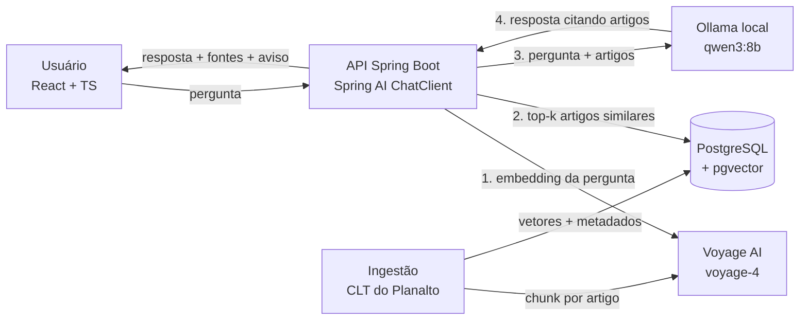

# Assistente CLT (RAG)

Assistente **informativo** sobre a Consolidação das Leis do Trabalho (CLT). Você pergunta em linguagem natural e recebe a resposta **com o artigo da lei de onde ela saiu**.

> ⚠️ **Não é aconselhamento jurídico.** Toda resposta da API traz esse aviso. Para o seu caso concreto, consulte um advogado trabalhista, o sindicato da sua categoria ou a Defensoria Pública.

    

**Status:** 🚧 passo 2 de 12 concluído. O esqueleto roda de ponta a ponta (API ↔ Ollama ↔ Postgres); o RAG ainda não foi implementado. Veja o [roadmap](#roadmap).

---

## O problema

Qualquer trabalhador brasileiro tem dúvidas sobre férias, rescisão, horas extras… e a resposta está na CLT, um texto longo e difícil de navegar. Um chatbot comum responde com segurança, mas **inventa artigos**. Este é o modelo do projeto respondendo *sem* RAG:

> **Pergunta:** Quantos dias de férias o trabalhador tem direito por ano?
>
> **Resposta do modelo (qwen3:8b, sem RAG):** "…direito a **30 dias de férias anuais**, conforme previsto no **Artigo 133 da CLT**. Além disso, o empregador deve pagar **1/3** do salário como **adiantamento de férias**… devem ser gozados em um período de 12 meses… conforme o **Artigo 133, §2º**…"

| O modelo disse | O que diz a lei |
|---|---|
| 30 dias "conforme Art. 133" | Os 30 dias estão no **Art. 130**. O Art. 133 trata de quando o empregado **perde** o direito a férias. |
| 1/3 é "adiantamento" previsto na CLT | É o **adicional de 1/3**, garantido pela **Constituição (art. 7º, XVII)**. A CLT (Art. 145) define o prazo de pagamento. |
| Prazo de 12 meses no "Art. 133, §2º" | O período concessivo está no **Art. 134**. |

Acertou o número e errou todas as citações. A resposta completa está em [`docs/exemplos/antes-do-rag.json`](docs/exemplos/antes-do-rag.json).

**A solução:** RAG (*Retrieval-Augmented Generation*). Antes de responder, o sistema busca os artigos relevantes da CLT num banco vetorial e obriga o modelo a responder **só com base neles**, citando a fonte.

## Arquitetura



| Camada | Tecnologia | Por quê |
|---|---|---|
| API | Java 25 · Spring Boot 4 · Spring AI 2 | `ChatClient` e `VectorStore` abstraem o provedor: trocar Ollama por Claude é configuração, não reescrita |
| Banco vetorial | PostgreSQL 17 + pgvector | Um banco só para dados e vetores, sem serviço extra |
| Embeddings | Voyage AI (`voyage-4`) | Parceira recomendada pela Anthropic; franquia gratuita cobre o corpus inteiro várias vezes |
| LLM | Ollama (`qwen3:8b`) | Custo zero e sem limite de uso durante o desenvolvimento; bom em português |
| Frontend | React + TypeScript | Chat com citações clicáveis para o texto oficial |

As decisões e alternativas avaliadas estão em [`docs/decisoes.md`](docs/decisoes.md).

## Rodando localmente

### Pré-requisitos
- JDK 25 e Maven 3.9+
- Docker Desktop (no Windows, com WSL 2)
- [Ollama](https://ollama.com/download)

### 1. Banco vetorial
```bash
docker compose up -d postgres
docker ps --filter name=cltrag        # esperado: (healthy) e 0.0.0.0:5433->5432/tcp
docker exec cltrag-postgres psql -U cltrag -d cltrag -c "\dx"   # deve listar "vector"
```
> O container usa a porta **5433** no host para não conflitar com um PostgreSQL já instalado na máquina.

### 2. Modelo local
```bash
ollama pull qwen3:8b
ollama run qwen3:8b "Responda em uma frase: o que é a CLT?"
```

| RAM disponível | Modelo sugerido | Download |
|---|---|---|
| 8 GB | `qwen3:4b` | ~3 GB |
| 16 GB | `qwen3:8b` (padrão) | ~5 GB |
| 32 GB+ ou GPU de 12–16 GB | `qwen3:14b` | ~9 GB |

Para trocar, defina `OLLAMA_MODEL` no ambiente.

### 3. Aplicação
```bash
mvn spring-boot:run
```

### 4. Testando
```bash
curl -s http://localhost:8080/actuator/health
# esperado: "db":{"status":"UP"...} e "status":"UP"

curl -s -X POST http://localhost:8080/api/smoke/chat \
  -H "Content-Type: application/json" \
  --data-binary @docs/exemplos/pergunta-ferias.json
```

Resposta (formato):
```json
{
  "answer": "...",
  "model": "qwen3:8b",
  "latencyMs": 8421,
  "promptTokens": 100,
  "completionTokens": 148,
  "disclaimer": "Ferramenta informativa baseada no texto da CLT. Não é aconselhamento jurídico. ..."
}
```

Algo deu errado? Veja o [troubleshooting](docs/troubleshooting.md), que tem os problemas reais encontrados no Windows durante o desenvolvimento.

### Configuração

| Variável | Padrão | Descrição |
|---|---|---|
| `POSTGRES_HOST` / `POSTGRES_PORT` | `localhost` / `5433` | Conexão com o banco |
| `POSTGRES_DB` / `POSTGRES_USER` / `POSTGRES_PASSWORD` | `cltrag` | Credenciais locais |
| `OLLAMA_BASE_URL` | `http://localhost:11434` | Servidor do Ollama |
| `OLLAMA_MODEL` | `qwen3:8b` | Modelo de geração |
| `VOYAGE_API_KEY` | — | Embeddings (a partir do passo 3) |

Modelo em [`.env.example`](.env.example).

## Endpoints

| Método | Rota | Descrição |
|---|---|---|
| `GET` | `/actuator/health` | Saúde da aplicação e do banco |
| `POST` | `/api/smoke/chat` | Pergunta direta ao LLM, **sem RAG** (teste de fumaça; será substituído no passo 4) |

## Roadmap

- [ ] **1. Corpus e eval set:** texto oficial da CLT (Planalto) e 15–20 perguntas com o artigo esperado
- [x] **2. Esqueleto:** Spring Boot + Spring AI, Postgres/pgvector via Docker, Ollama local
- [ ] **3. Ingestão:** CLT → chunks por artigo → embeddings Voyage → pgvector
- [ ] **4. Endpoint de RAG:** busca top-k + citação obrigatória do artigo
- [ ] **5. Observabilidade e custo:** tokens, latência e custo por chamada
- [ ] **6. Avaliação:** taxa de acerto do artigo recuperado no eval set
- [ ] **7. Frontend:** chat React com citações clicáveis e aviso sempre visível
- [ ] **8. Guardrails:** rate limiting, tratamento de erros, perguntas fora do escopo
- [ ] **9. Deploy:** Azure, containerizado
- [ ] **10. Documentação final:** diagrama, GIF, números do eval
- [ ] **11. Divulgação**
- [ ] **12. Checkpoint:** avaliar a troca do Ollama pelo Claude (API Anthropic) na versão final

O passo a passo do desenvolvimento, com problemas e soluções, está no [diário](docs/diario-de-desenvolvimento.md).

## Estrutura

```
clt-rag-assistant/
├── docker-compose.yml              # Postgres + pgvector (porta 5433); Ollama opcional
├── docker/postgres/init/           # cria a extensão vector
├── docs/
│   ├── decisoes.md                 # decisões de arquitetura e alternativas
│   ├── diario-de-desenvolvimento.md
│   ├── troubleshooting.md
│   └── exemplos/                   # requisições e respostas de referência
└── src/main/java/br/com/caiomilani/cltassistant/
    ├── api/SmokeController.java    # POST /api/smoke/chat
    ├── config/ChatClientConfig.java# ChatClient + prompt de sistema
    └── shared/Disclaimer.java      # texto único do aviso jurídico
```

## Fonte dos dados

Texto da CLT: [Decreto-Lei nº 5.452/1943, no portal do Planalto](https://www.planalto.gov.br/ccivil_03/decreto-lei/del5452.htm), a publicação oficial e atualizada.

## Autor

**Caio Milani Correa**: Engenheiro de Software Full-Stack (Java/Spring Boot · React/Angular).
