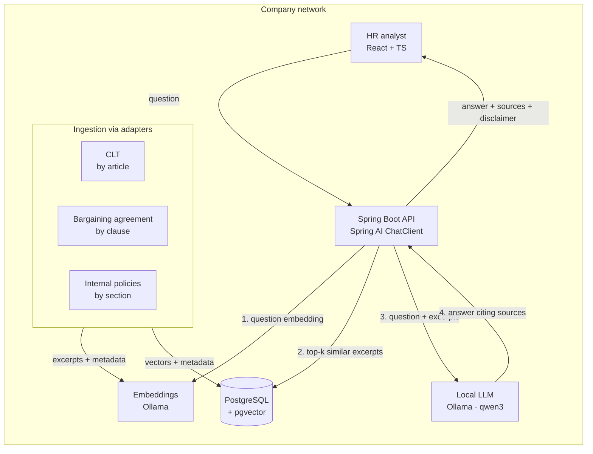

# Labor Law Assistant (on-premise RAG)

> **A labor-law assistant for HR teams, built with RAG and running fully on-premise:** for each question, it gathers what Brazilian labor law (CLT), the collective bargaining agreement and the company's internal policies say, shows how these rules rank against each other, and cites the source of every excerpt. **No data ever leaves the company network.**

> ⚠️ **Not legal advice.** The assistant organizes and cites the rules; the decision always belongs to a professional. Every API response carries this disclaimer.

     

**Status:** 🚧 Layer 1 (MVP with the CLT), step 2 done. The skeleton runs end to end (API ↔ Ollama ↔ Postgres); RAG is not implemented yet. See the [roadmap](#roadmap).

> The product targets Brazilian companies, so the app itself (prompts, answers, disclaimer) is in Portuguese. Design notes in [`docs/`](docs/) are also in Portuguese.

---

## Problem and goals

### The problem

1. **The rules are scattered.** In Brazil, an HR analyst's answer to "what is this employee entitled to?" depends on several documents at once: the federal labor code (CLT), the collective bargaining agreement for the employee's category, sometimes a company-level agreement, and internal policies. They overlap, override each other under specific legal rules, and live in long PDFs. Cross-referencing them by hand is slow, and mistakes become labor claims and fines.
2. **General-purpose AI makes things up.** Asked a simple vacation question, the LLM used in this project cited the wrong articles and, without guidance, invented an entire law ([see below](#the-problem-rag-solves)). For legal questions, a confident wrong answer is worse than no answer.
3. **Cloud AI is often off the table.** HR questions involve sensitive employee situations, and internal policies and agreements are company documents. Sending them to an external API raises data-protection (LGPD) and confidentiality concerns, and many companies simply won't allow it.

### Goals

**Product**
- Answer *"which rule applies here?"* by gathering what each source says, pointing out how the sources rank, and **citing every excerpt** so the analyst can verify it.
- Run **entirely inside the company network**: no question, document or answer leaves it.

**Engineering**
- **Grounded answers:** the model answers only from retrieved excerpts, with a mandatory citation, or says it couldn't find the answer.
- **Measurable quality:** an eval set of real HR questions with expected articles, so quality is a number rather than an impression.
- **Provider-agnostic:** local (Ollama) or cloud (Voyage AI, Claude) models are a configuration switch, so the cost of staying offline can be measured instead of assumed.
- **Practical to deploy:** one `docker compose` brings up the whole stack on a single machine with a consumer-grade GPU.

### Success criteria

| Criterion | Target | Status |
|---|---|---|
| Every answer cites its source, or explicitly says nothing was found | 100% of eval answers | **100%** (24/24) on the development set; on the validation set, 3/3 out-of-scope refusals but 4 answerable questions refused |
| The expected article is among the retrieved excerpts | ≥ 90% of eval questions (top-5) | **100%** (21/21) on the development set; **78.3%** (18/23) on the held-out validation set, where HR jargon ("12x36", "home office") misses the legal wording ([validation](docs/eval/README.md#primeira-execução-da-validação-2026-11-13)) |
| The answer says only what the cited excerpts support | 100% of eval answers | **81%** (17/21) on the development set; **48%** (11/23) on the held-out validation set, plus 5 partially correct (manual review) |
| No external network calls in the `offline` profile | 0 calls | By design; to be verified in step 9 |
| Response time on a 6 GB consumer GPU | ≤ 15 s per answer, including retrieval | **2.6 s average, 5.8 s max** on the validation set (down from ~90 s on CPU without RAG; see [performance](#model-choice-and-performance)) |

### Non-goals

- **Not legal advice, and it doesn't decide.** It organizes and cites the rules; deciding which one prevails in a specific case is legal interpretation and stays with a professional.
- **No employee data** (salaries, timesheets, records) and **no actions** (severance calculations, scheduling). This keeps the scope clear and the LGPD exposure small.
- **Not a generic "chat with your documents" tool.** That space is already well served. The value here is domain knowledge: knowing how labor rules relate to each other.

## Who it is for

**User:** HR and payroll analysts, who check the cited source before acting.

**The question it answers:** *"which rule applies here?"* In Brazilian labor law, the answer is rarely in a single document. The rules form a hierarchy:

| Source | What it is | How it relates to the others |
|---|---|---|
| **CLT** (*Consolidação das Leis do Trabalho*) | The federal labor code | The baseline of rights |
| **Collective bargaining agreement** (*Convenção Coletiva*, CCT) | Negotiated between the unions of a professional category | Overrides the law on the topics listed in **Art. 611-A** (working hours, hour banks, breaks…), but cannot reduce what **Art. 611-B** protects (FGTS, 13th salary, vacation…) |
| **Company-level agreement** (*Acordo Coletivo*, ACT) | Negotiated with a specific company | Overrides the collective bargaining agreement (**Art. 620**) |
| **Internal policy** | The company's own rules | Can grant more than the law, never less |

Today, answering means opening several PDFs and searching clause by clause. The assistant does the search, **shows what each source says, points out the hierarchy and cites the excerpts**. The analyst makes the call.

**Why on-premise:** with the language model and embeddings running locally (Ollama), no question or document leaves the network. There is no per-request cost, and it works even in air-gapped environments.

## The problem RAG solves

An LLM without access to the rules answers confidently but **makes up its sources**. This is the project's model answering *without* RAG:

> **Question:** *"Quantos dias de férias o trabalhador tem direito por ano?"* (How many vacation days does a worker get per year?)
>
> **Model answer (qwen3:8b, no RAG), translated:** "…entitled to **30 days of annual vacation**, as set out in **Article 133 of the CLT**. In addition, the employer must pay **1/3** of the salary as a **vacation advance**… to be taken within a 12-month period… as provided in **Article 133, §2**…"

| What the model said | What the law says |
|---|---|
| 30 days "under Art. 133" | The 30 days are in **Art. 130**. Art. 133 covers when an employee **loses** the right to vacation. |
| The 1/3 is an "advance" defined in the CLT | It is the **one-third bonus** guaranteed by the **Federal Constitution (art. 7, XVII)**. The CLT (Art. 145) sets the payment deadline. |
| 12-month window in "Art. 133, §2" | The window for granting vacation is in **Art. 134**. |

It got the number right and every citation wrong. With no system prompt at all, it was worse: the same model claimed workers get **"15 days + 1 per year of service"** under **"Law No. 11,091/2005"**, which actually governs the careers of administrative staff at federal universities and has nothing to do with vacation under the CLT.

| Scenario | Result |
|---|---|
| No system prompt | Makes up the rule **and** the law ([`sem-prompt-de-sistema.json`](docs/exemplos/sem-prompt-de-sistema.json)) |
| With a system prompt | Gets the rule right, makes up the articles ([`antes-do-rag.json`](docs/exemplos/antes-do-rag.json)) |
| **With RAG** | **"30 dias corridos, quando não houver faltado ao serviço mais de 5 vezes (Art. 130, I)"**: right rule, right article and item, in 1.7 s ([`com-rag-ferias.json`](docs/exemplos/com-rag-ferias.json)) |

The made-up answers also **change from run to run and from model to model**. Asked the same question without a system prompt, the 8B model has also answered "3 days for up to 12 months of service", and the smaller 4B model answered "13 business days under Law No. 6,015/1973" (Brazil's public registries law). Three runs without a system prompt, three different made-up rules, all stated with confidence. The model's own memory can't be trusted for legal facts; it has to read them from the source. Even with the system prompt, the 4B model cited **the right article (Art. 130) with the wrong rule** ("12 business days"). A correct citation attached to a false claim is the most dangerous failure, which is why the eval checks that each answer is supported by its excerpts, not just that it cites the right article ([example](docs/exemplos/com-prompt-4b-instruct.json)).

**The solution:** RAG (*Retrieval-Augmented Generation*). Before answering, the system retrieves the relevant excerpts from a vector database and requires the model to answer **only from them**, citing the source.

**Results so far** (laptop GPU, everything local). The system was tuned on a **development set** of 24 questions; a **held-out validation set** of 26 new questions, frozen before its first run and never used for tuning, measures how much of that generalizes:

| | Development (24) | **Held-out validation (26)** |
|---|---|---|
| Correct article among the top 5 retrieved | 100% | **78.3%** (18/23) |
| Answers fully supported by their excerpts (manual review) | 81% (17/21) | **48%** (11/23) |
| Partially supported (right rule, missing a condition or wrong citation) | 3 | 5 |
| Wrong answers | 1 | 3 |
| Answerable questions refused | 0 | 4 (3 because retrieval missed the article) |
| Out-of-scope questions refused | 3/3 | **3/3** |
| Average response time | 2.5 s | 2.6 s |

**The held-out set exposed what the development set hid.** The development questions were written with the law open, so they shared its vocabulary. The validation questions use HR jargon, and that is where retrieval breaks: "12x36 shift" never reaches "twelve consecutive hours followed by thirty-six" (Art. 59-A), "home office" never reaches "teleworking" (Art. 75-C). When retrieval misses, the model usually **refuses instead of inventing** (3 of 5 misses), which is the safe failure. The other gaps are the 4B model picking the wrong excerpt among the right ones and falling for a trap question (pregnancy job security: the CLT grants it, but the duration is in the Constitution). Next: an HR-to-legal glossary to expand queries, and a larger model ([validation analysis](docs/eval/README.md#primeira-execução-da-validação-2026-11-13)).

Earlier milestones on the development set: indexing by provision (each paragraph as its own vector, while the LLM still gets the whole article) took retrieval from 90.5% to 100%; hybrid keyword + vector search was measured and **rejected** because it made retrieval worse; a deterministic citation verifier now catches wrong paragraph and item numbers and reduces them to the article ([analysis](docs/eval/README.md)).

**First result (retrieval only):** for **90.5%** of the eval questions, the correct CLT article is among the top 5 excerpts retrieved, from 834 articles ingested in 40 seconds on a laptop GPU. Asked *"Qual o prazo para a empresa pagar as férias?"* ("When must the company pay vacation?"), the search returns Art. 145 first, the exact article the model without RAG couldn't cite. The two misses share one cause, documented in the [eval analysis](docs/eval/README.md#resultados).

## Architecture



In the **`offline`** profile (the default), everything above runs inside the network. An optional **`cloud`** profile swaps embeddings for Voyage AI and, later, the LLM for Claude, to compare quality and latency on the eval set. Switching is a configuration change, not a code change.

| Layer | Technology | Why |
|---|---|---|
| API | Java 25 · Spring Boot 4 · Spring AI 2 | `ChatClient`, `EmbeddingModel` and `VectorStore` abstract the provider, so going from local to cloud is configuration |
| Vector store | PostgreSQL 17 + pgvector | One database for data and vectors, easy to host on-premise |
| Embeddings | Ollama `bge-m3` (offline) · Voyage AI (cloud) | Offline by default; the cloud is only a baseline for comparison |
| LLM | Ollama (`qwen3:4b-instruct`) | Runs locally with no per-request cost; fits a 6 GB GPU next to the embedding model |
| Ingestion | One adapter per source type | The CLT has its own structure (article/paragraph/item); agreements and policies arrive as PDF/DOCX |
| Retrieval | Vector and/or Postgres full-text, fused with RRF; article- or provision-level | Both options are switchable per request, so each is measured on the eval set before becoming the default |
| Answer checking | Deterministic citation verifier | Every cited article, paragraph and item is checked against the retrieved text, so a wrong citation shows up in the metrics instead of in front of the analyst |
| Frontend | React + TypeScript | Chat with clickable citations to the text of each source |

Decisions and the alternatives considered are in [`docs/decisoes.md`](docs/decisoes.md) (Portuguese).

## Running locally

### Prerequisites
- JDK 25 and Maven 3.9+
- Docker Desktop (on Windows, with WSL 2)
- [Ollama](https://ollama.com/download)

### 1. Vector database
```bash
docker compose up -d postgres
docker ps --filter name=cltrag        # expected: (healthy) and 0.0.0.0:5433->5432/tcp
docker exec cltrag-postgres psql -U cltrag -d cltrag -c "\dx"   # should list "vector"
```
> The container is exposed on host port **5433** so it doesn't clash with a PostgreSQL already installed on the machine.

### 2. Local models
```bash
ollama pull qwen3:4b-instruct-2507-q4_K_M   # chat, ~2.5 GB
ollama pull bge-m3                          # embeddings, ~1.2 GB (used from step 3)
ollama run qwen3:4b-instruct-2507-q4_K_M "Responda em uma frase: o que é a CLT?"
ollama ps                                   # PROCESSOR should read "100% GPU"
```

Together the two models take about 4 GB of VRAM, so they fit on a 6 GB GPU. With more VRAM (12 GB+), a larger instruct model is an option; set `OLLAMA_MODEL` to switch. Avoid "thinking" variants (see [why](#reasoning-models-and-the-instruct-variant)).

### 3. Application
```bash
mvn spring-boot:run      # run from the project root: the corpus and eval paths are relative to it
```
On first start, Spring AI creates the `trechos_normativos` table and its HNSW index in Postgres.

### 4. Ingest the CLT
```bash
curl -s -X POST http://localhost:8080/api/ingestao/clt
# {"fonte":"clt","trechos":834,"duracaoMs":...}
```
Parses the official HTML, embeds each article with `bge-m3` and stores it in pgvector. Safe to re-run: documents have stable ids and are replaced, not duplicated.

### 5. Search and measure retrieval
```bash
# semantic search only, no LLM: which articles match the question?
curl -s "http://localhost:8080/api/busca?k=3&q=prazo+para+pagar+as+f%C3%A9rias"

# run the whole eval set against the search and get the hit rate
curl -s -X POST "http://localhost:8080/api/avaliacao/recuperacao?k=5"
```

### 6. Ask a question (RAG)
```bash
curl -s -X POST http://localhost:8080/api/perguntas \
  -H "Content-Type: application/json" \
  --data-binary @docs/exemplos/pergunta-rag-ferias.json
```
The response carries the answer with inline citations, the retrieved sources (reference, link, similarity), a citation check, latency, tokens and the disclaimer. The citation check is deterministic (no second LLM call) and runs on every answer:
- `foraDosTrechos`: articles cited that were *not* among the retrieved excerpts (the model answered from memory);
- `problemasDeDispositivo`: a cited paragraph or item that does not exist in the retrieved article (`"Art. 145, I"`), or a sentence whose numbers are not in the cited provision (`"24 days (Art. 130, I)"`, where 24 is in item II). Spelled-out numbers in the law ("trinta") count, and numbers taken from the question are ignored.

When a paragraph or item citation is flagged, the answer is **delivered with that citation reduced to the article** (`"(Art. 130, I)"` becomes `"(Art. 130)"`): the article is always verified against the retrieved text, and a less precise but correct source is safer for the analyst than a precise wrong one. The model's original text is kept in `respostaOriginal` for auditing.

To run the whole eval set through the RAG pipeline (one LLM call per question, takes a few minutes):
```bash
curl -s -X POST "http://localhost:8080/api/avaliacao/respostas?k=5"
```

### 7. Smoke test of the LLM (no RAG)
```bash
curl -s http://localhost:8080/actuator/health
# expected: "db":{"status":"UP"...} and "status":"UP"

curl -s -X POST http://localhost:8080/api/smoke/chat \
  -H "Content-Type: application/json" \
  --data-binary @docs/exemplos/pergunta-ferias.json
```

Response shape:
```json
{
  "answer": "...",
  "model": "qwen3:4b-instruct-2507-q4_K_M",
  "latencyMs": 8421,
  "promptTokens": 100,
  "completionTokens": 148,
  "disclaimer": "Ferramenta informativa baseada no texto da CLT. Não é aconselhamento jurídico. ..."
}
```

Something went wrong? See the [troubleshooting guide](docs/troubleshooting.md) (Portuguese), built from the real issues hit on Windows during development.

### Configuration

| Variable | Default | Description |
|---|---|---|
| `POSTGRES_HOST` / `POSTGRES_PORT` | `localhost` / `5433` | Database connection |
| `POSTGRES_DB` / `POSTGRES_USER` / `POSTGRES_PASSWORD` | `cltrag` | Local credentials |
| `OLLAMA_BASE_URL` | `http://localhost:11434` | Ollama server |
| `OLLAMA_MODEL` | `qwen3:4b-instruct-2507-q4_K_M` | Generation model |
| `VOYAGE_API_KEY` | — | Embeddings for the `cloud` profile (optional, from step 3) |

Template in [`.env.example`](.env.example).

### Model configuration (Ollama)

From [`application.yml`](src/main/resources/application.yml):

```yaml
spring:
  ai:
    model:
      embedding: none
    ollama:
      base-url: ${OLLAMA_BASE_URL:http://localhost:11434}
      chat:
        options:
          model: ${OLLAMA_MODEL:qwen3:4b-instruct-2507-q4_K_M}
          temperature: 0.2
```

| Property | Value | What it does |
|---|---|---|
| `spring.ai.model.embedding` | `none` | Disables, for now, the embedding model the Ollama starter would create by default. The embedding provider (Ollama in the `offline` profile, Voyage in `cloud`) is configured with ingestion, in step 3. |
| `ollama.base-url` | `http://localhost:11434` | Address of Ollama's HTTP API (11434 is the default port). Changes on deployment, when Ollama runs on another host or container. |
| `chat.options.model` | `qwen3:4b-instruct-2507-q4_K_M` | Which model answers: Qwen3 4B, *instruct* variant (no reasoning mode), 4-bit quantized. It must be pulled first (`ollama pull`), otherwise the API returns `404 model not found`. Details below. |
| `chat.options.temperature` | `0.2` | How much randomness goes into word choice. Details below. |

#### `temperature`: creativity vs. predictability

An LLM generates text **one token at a time**. For each next token, the model scores every option in its vocabulary and turns those scores into probabilities. Then it **samples** one of them according to those probabilities.

Temperature comes in **before** sampling: the scores are divided by it.

- **Low temperature (close to 0):** the gaps between scores grow. The most likely option takes almost all the probability, so the model nearly always picks "the obvious word". Output is predictable, repeatable and conservative.
- **Temperature 1:** probabilities stay as the model learned them.
- **High temperature (above 1):** probabilities flatten and unlikely options gain ground. Output is more varied and "creative", but also more likely to drift off topic and make mistakes.

An intuitive example, completing *"O trabalhador tem direito a 30 dias de…"* ("Workers are entitled to 30 days of…"):

| Next token | Temp. 0.2 | Temp. 1.0 | Temp. 1.5 |
|---|---|---|---|
| "férias" (vacation) | ~100% | 80% | ~67% |
| "descanso" (rest) | <1% | 15% | ~22% |
| "folga" (time off) | ~0% | 5% | ~11% |

*(Illustrative: starts from the 1.0 column's probabilities and applies the temperature formula.)*

**Why `0.2` here:** in a RAG-based legal assistant, the answer should **faithfully reproduce the retrieved articles**, not "rewrite the law creatively". A low temperature keeps the model close to the source text and gives similar answers to the same question. It also matters for the **eval set**: with little randomness, a change in results tends to come from a change in the code, not from luck.

**Why not `0`:** at zero temperature (always picking the most likely token), small models tend to fall into loops and repetition. `0.2` keeps things predictable with a minimal margin of variation.

**What temperature does not fix:** a low temperature **does not prevent hallucination**. It only makes the model more *consistent* in what it says, even when it is wrong. The no-RAG test (see [The problem RAG solves](#the-problem-rag-solves)) already ran at `0.2` and confidently invented the articles. What fixes hallucination is RAG: giving the model the text of the law and requiring it to cite the source.

> Typical use: 0–0.3 for extraction, factual answers and RAG; 0.5–0.8 for general chat; above 1 for brainstorming and creative writing.

#### Reasoning models and the instruct variant

Some models generate internal reasoning (*chain of thought*) before answering. That helps with math or multi-step problems, but in RAG the hard part (finding the information) is already done by the vector search; the model only needs to **read the retrieved excerpts and write the answer**. Reasoning just adds latency.

Turning it off turned out to be the tricky part:
- `qwen3:8b` is a hybrid model. Ollama's API accepts `"think": false`, but setting `think: false` through Spring AI **had no effect** (still ~600 output tokens).
- The default `qwen3:4b` tag is a **reasoning-only** model: it ignored `"think": false` and wrote a long English monologue before the answer (**1,230 tokens** for an answer of under 100).
- The **instruct** variant (`qwen3:4b-instruct-2507`) has no reasoning mode at all. Same size, direct answers. That's the one used here.

#### Model choice and performance

Measured on the development machine (RTX 3060 Laptop, 6 GB VRAM; 16 GB RAM), same question, through Ollama's API:

| Model | Runs on | Speed | Total time | Notes |
|---|---|---|---|---|
| `qwen3:8b` (old NVIDIA driver) | 100% CPU | 6.4 tokens/s | ~89 s | GPU not detected |
| `qwen3:8b` (driver updated) | 30% CPU / 70% GPU | 13.7 tokens/s | ~43 s | Doesn't fit in 6 GB; no room left for embeddings |
| `qwen3:4b` (reasoning) | 100% GPU | 78 tokens/s | ~16 s | 1,230 tokens, mostly reasoning |
| **`qwen3:4b-instruct-2507`** | **100% GPU** | **85 tokens/s** | **~5 s** | **Chosen.** Fits on the GPU alongside `bge-m3` |

That's **~13x faster** than where the project started. Two lessons for on-premise sizing: **the model has to fit entirely in VRAM** (a partial split runs at a fraction of GPU speed), and **the chat model and the embedding model share that VRAM**.

**The trade-off:** a 4B model knows less than an 8B one, and without RAG it hallucinates just as freely (see [The problem RAG solves](#the-problem-rag-solves)). That's acceptable by design: with RAG the model doesn't need to *know* the law, it needs to *read* it. The eval set will confirm whether the 4B model reads well enough, and the 8B model stays one variable away for comparison.

## Endpoints

| Method | Route | Description |
|---|---|---|
| `GET` | `/actuator/health` | Application and database health |
| `POST` | `/api/smoke/chat` | Asks the LLM directly, **without RAG** (smoke test; replaced in step 4) |
| `POST` | `/api/perguntas` | **The assistant.** Body `{"pergunta": "…", "k": 5}`. Answer with citations, sources, citation check, metrics and disclaimer |
| `POST` | `/api/avaliacao/respostas?k=5` | Runs the eval set through the full RAG: citation rate, citations outside the retrieved excerpts, refusals, latency |
| `POST` | `/api/ingestao/{fonte}` | Ingests a source into the vector store (`clt` for now). Idempotent |
| `GET` | `/api/busca?q=…&k=5` | Search only, no LLM: top-k articles with reference, link, matching provision and scores. Optional `granularidade=artigo\|dispositivo` and `estrategia=vetorial\|hibrida` |
| `POST` | `/api/avaliacao/recuperacao?k=5` | Runs the eval set against the search: hit rate, MRR and per-question results. Same optional `granularidade` / `estrategia` parameters, to compare retrieval setups without restarting |

## Roadmap

The project ships in layers. Each layer works on its own and can be published.

### Layer 1: MVP with the CLT (offline)
- [x] **1. Corpus and eval set:** official CLT text (Planalto, the federal government's legislation portal), bundled in the repository, plus 24 HR questions with the expected article ([`docs/eval`](docs/eval/README.md))
- [x] **2. Skeleton:** Spring Boot + Spring AI, Postgres/pgvector via Docker, local Ollama
- [x] **3. Adapter-based ingestion:** CLT adapter (one chunk per article, metadata shared across all sources), local embeddings (`bge-m3`), search and retrieval eval endpoints. 834 articles ingested in 40 s; **retrieval hit rate 90.5% (top-5)**. The `cloud` profile moved to step 6, where it is compared
- [x] **4. RAG endpoint:** top-k retrieval + mandatory source citation + check for citations outside the retrieved excerpts. Citation 91.7%, faithfulness 81%, 3/3 out-of-scope refusals, 1.6 s average
- [ ] **5. Observability:** tokens, latency and cost per call
- [ ] **6. Evaluation:** retrieval hit rate for the correct source; `offline` vs. `cloud` comparison
- [ ] **7. Frontend:** React chat with clickable citations and an always-visible disclaimer
- [ ] **8. Guardrails:** error handling and out-of-scope questions
- [ ] **9. On-premise packaging:** full `docker compose` (Postgres, Ollama with GPU, API, frontend), with no external dependencies
- [ ] **10. Docs and launch:** diagram, GIF, eval numbers

### Layer 2: the template (a second source)
- [ ] Adapter for collective bargaining agreements (PDF, chunked by clause), tested with a real public agreement
- [ ] Answers showing both sources side by side, with the hierarchy pointed out
- [ ] Eval cases on topics where agreements often diverge from the CLT (breaks, hour banks)

### Layer 3: the vision
- [ ] Internal policies and company-level agreements as sources
- [ ] Legal corpus update package for installs without internet access
- [ ] Access control per document collection
- [ ] Checkpoint: evaluate Claude (Anthropic API) as the `cloud` profile's LLM

The step-by-step development history, with problems and fixes, is in the [dev log](docs/diario-de-desenvolvimento.md) (Portuguese).

## Project structure

```
clt-rag-assistant/
├── docker-compose.yml              # Postgres + pgvector (port 5433); optional Ollama
├── docker/postgres/init/           # creates the vector extension
├── corpus/clt/DEL5452.html         # official CLT text, versioned (hash pinned in the eval set)
├── docs/                           # design notes (Portuguese)
│   ├── decisoes.md                 # architecture decisions and alternatives
│   ├── diario-de-desenvolvimento.md# dev log
│   ├── troubleshooting.md
│   ├── eval/                       # eval set: questions, expected articles, excerpts
│   └── exemplos/                   # reference requests and responses
├── tools/                          # Python helpers: parser prototype, eval set builder
└── src/main/java/br/com/caiomilani/cltassistant/
    ├── ingestao/                   # source-agnostic ingestion: TrechoNormativo, AdaptadorFonte, IngestaoService
    │   └── clt/                    # CLT adapter + HTML parser (rules in tools/README.md, tested in CltHtmlParserTest)
    ├── busca/                      # GET /api/busca: semantic search, no LLM
    ├── rag/                        # POST /api/perguntas: retrieval + prompt rules + LLM + citation check
    ├── avaliacao/                  # POST /api/avaliacao/{recuperacao,respostas}: eval set vs. search and vs. full RAG
    ├── api/SmokeController.java    # POST /api/smoke/chat
    ├── config/ChatClientConfig.java# ChatClient + system prompt
    └── shared/Disclaimer.java      # single source for the legal disclaimer
```

## Data sources

- **CLT:** [Decree-Law No. 5,452/1943 on the Planalto portal](https://www.planalto.gov.br/ccivil_03/decreto-lei/del5452.htm), the official, up-to-date publication. It is the system's legal baseline and the eval set's test base.
- **Collective bargaining agreements (Layer 2):** registered and publicly available in the Ministry of Labor's *Mediador* system.

## Author

**Caio Milani Correa**: Full-Stack Software Engineer (Java/Spring Boot · React/Angular).
