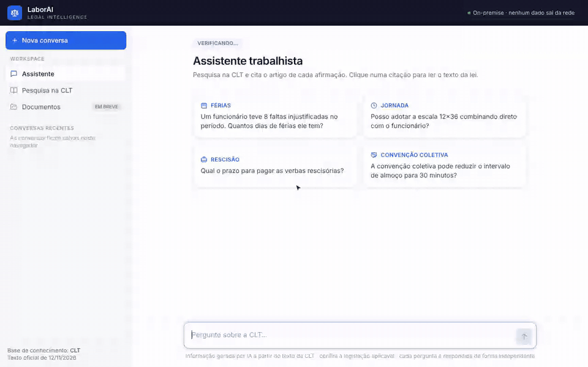
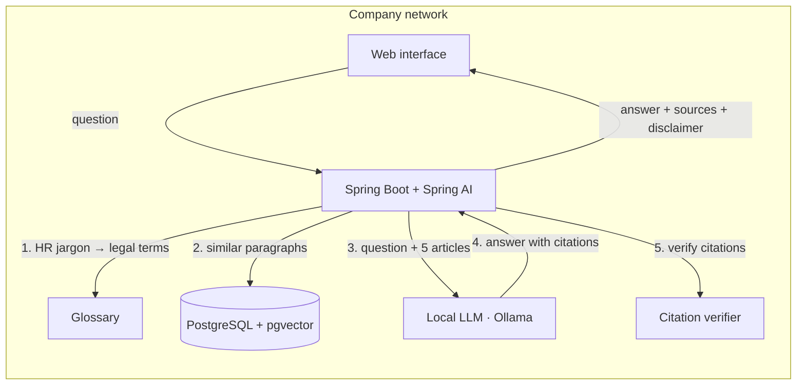

# Labor Law Assistant (on-premise RAG)

> **A labor-law assistant for HR teams that runs entirely on-premise.** It answers questions about Brazilian labor law (CLT), cites the article behind every claim, and never sends a question or document outside the company network.

         



<sub>The answers in this recording are real outputs of the system, recorded during the evaluation run and replayed with their measured response time (2.6 s on a 6 GB laptop GPU). The first question uses HR jargon ("22h"), which the glossary translates into the law's wording; a paragraph citation the model got wrong was automatically reduced to the article. The last question is outside the CLT, and the assistant says so instead of inventing an answer.</sub>

> ⚠️ **Not legal advice.** The assistant organizes and cites the rules; the decision belongs to a professional. Every answer carries this disclaimer.

---

## 🐳 Run it with one command

The whole stack (vector database, local models, API and web interface) comes up with Docker Compose. No Java, Maven or Ollama install needed.

```bash
git clone https://github.com/caiomilanic/clt-rag-assistant.git
cd clt-rag-assistant

docker compose -f docker-compose.yml -f docker-compose.gpu.yml up -d    # NVIDIA GPU (recommended)
docker compose up -d                                                    # no GPU: runs on CPU, slower
```

Other hardware (AMD, Apple Silicon): see [hardware](#hardware).

Then open **http://localhost:8080**.

The first run downloads the models (about 4 GB) and indexes the CLT, which takes a few minutes; follow it with `docker compose logs -f app`. After that, everything is stored in volumes and **the stack runs with no internet connection**.

| Container | What it does |
|---|---|
| `postgres` | PostgreSQL 17 + pgvector: the CLT's 834 articles and 1,861 paragraphs as vectors |
| `ollama` | Runs the language model (`qwen3:4b-instruct`) and the embedding model (`bge-m3`) locally. Not exposed outside the Compose network |
| `modelos` | Pulls both models once, then exits |
| `app` | Spring Boot API + React interface, on the same port. Indexes the CLT on first start if the database is empty |

### Hardware

The language model generates text by running billions of operations per token, so speed depends almost entirely on the GPU, and the model must fit entirely in its memory (VRAM). Both models together take about 4 GB.

| Machine | How to run | What to expect |
|---|---|---|
| **NVIDIA GPU, 6 GB+ VRAM** | `-f docker-compose.gpu.yml` (needs the NVIDIA driver; on Windows, Docker Desktop with WSL 2) | **About 2–3 s per answer** (measured on an RTX 3060 Laptop, 6 GB) |
| NVIDIA GPU with less VRAM | same | Works, but the model is split between GPU and CPU, which is several times slower |
| **AMD GPU on Linux** | `-f docker-compose.amd.yml` (ROCm image; needs the ROCm driver on the host) | GPU speed, depending on the card. Not tested by the author |
| **AMD GPU on Windows, or Apple Silicon Mac** | Install [Ollama](https://ollama.com/download) on the machine, pull the models, then `-f docker-compose.ollama-local.yml` | Docker can't use these GPUs; Ollama installed natively can. Not tested by the author |
| No GPU | `docker compose up -d` | Works, but answers take many times longer, and the first indexing takes longer too. Not measured yet |

**Memory:** reserve about 8 GB of RAM for Docker (on Windows, check the WSL 2 memory limit) and about 10 GB of disk for images and models.

<details>
<summary>Using Ollama installed on the machine</summary>

```bash
ollama pull qwen3:4b-instruct-2507-q4_K_M
ollama pull bge-m3
docker compose -f docker-compose.yml -f docker-compose.ollama-local.yml up -d
```

The `ollama` and `modelos` containers are skipped and the app talks to the host's Ollama at `host.docker.internal:11434`. On Linux, start Ollama with `OLLAMA_HOST=0.0.0.0` so the container can reach it.

</details>

## Why

1. **The rules are scattered.** An HR analyst's answer to *"what is this employee entitled to?"* depends on the labor code, the collective bargaining agreement, sometimes a company agreement and internal policies, which override each other under specific legal rules. Cross-checking them by hand is slow, and mistakes become labor claims.
2. **General-purpose AI makes things up.** Asked how many vacation days a worker gets, the model used here, without RAG, cited the wrong articles; without a system prompt, it invented a law ([examples](docs/exemplos/)). In legal questions, a confident wrong answer is worse than no answer.
3. **Cloud AI is often off the table.** HR questions involve sensitive situations and confidential documents. Sending them to an external API raises data-protection (LGPD) concerns that many companies won't accept.

**Who it is for:** HR and payroll analysts, who check the cited source before acting. **What it doesn't do:** decide cases, handle employee data or take actions.

## How it works



- **Retrieval indexes paragraphs, returns articles.** Each paragraph is its own vector, so a specific rule is easy to find; the model still receives the whole article, so it has the full context.
- **An HR-to-legal glossary** bridges jargon and legal wording ("12x36 shift" → "twelve consecutive hours followed by thirty-six hours of rest"). It is a JSON file outside the code, so each company can add its own terms.
- **The prompt forces grounded answers:** only from the retrieved excerpts, with a citation for every claim, or a fixed "not found" sentence.
- **A deterministic citation verifier** (no second LLM call) checks every cited article, paragraph and item against the retrieved text. A wrong paragraph citation is reduced to the article before the answer is shown; the original is kept for auditing.

| Layer | Technology |
|---|---|
| API | Java 25 · Spring Boot 4 · Spring AI 2 (`ChatClient`, `VectorStore`) |
| Vector store | PostgreSQL 17 + pgvector (HNSW, cosine) |
| Models | Ollama: `qwen3:4b-instruct` (chat) + `bge-m3` (embeddings), together ~4 GB of VRAM |
| Interface | React 19 · TypeScript · Vite · Tailwind CSS · Lucide icons; fonts bundled, so it works offline. Assistant, direct search in the CLT, and a Documents screen reserved for the next layer |
| Packaging | Docker Compose, optional NVIDIA GPU |
| Tooling | Python scripts in [`tools/`](tools/): parser prototype and evaluation-set builder (not part of the running app) |

### What the Python is for

The running system is Java (API) and TypeScript (interface). Python (3.10+, tested on 3.13; the parser needs `beautifulsoup4` and `lxml`) is used only for engineering tools in [`tools/`](tools/), which is why GitHub shows it in the language bar:

- **`tools/corpus/parse_clt.py`:** a quick prototype of the CLT parser, written before the Java one and then kept as an independent second implementation. Comparing both outputs article by article caught real bugs in the Java parser (an article read wrongly, another dropped by mistake).
- **`tools/eval/build_eval.py`:** builds both evaluation sets. The questions and expected articles are written in the script, which is most of its size; the legal excerpts that justify each answer are **copied from the official text, never typed by hand**, and the script fails if one isn't found. It also records the SHA-256 of the CLT file, so every answer key is tied to a specific version of the law.

## Results

Quality is measured on two question sets with expected articles and manual review of every answer: a **development set** used for tuning, and a **held-out validation set**, frozen before each change and never used for tuning.

| | Development (26 + 3 out of scope) | Held-out validation (23 + 3 out of scope) |
|---|---|---|
| Correct article among the 5 retrieved | **96.2%** | **87.0%** |
| Answers fully supported by the cited excerpts | 81% (21/26) | 57% (13/23) |
| Out-of-scope questions correctly refused | 3/3 | 3/3 |
| Average response time (6 GB laptop GPU) | 2.3 s | 2.3 s |

**What the numbers say:**
- **The held-out set caught what the development set hid.** The first questions were written with the law open and shared its vocabulary (retrieval: 100%). Questions in HR jargon dropped retrieval to 78%. The glossary brought the development set back to 96%; new jargon it doesn't know still misses.
- **Retrieval is no longer the bottleneck. The 4B model's reading is.** Most remaining errors happen with the right article retrieved: the model inverts a paragraph or draws the wrong conclusion, and it varies between runs. That is the trade-off of a model small enough for a laptop GPU, and a larger model is a configuration change away.
- **When it fails, it usually fails safe.** When retrieval misses, the model refuses instead of inventing in most cases, and in the latest runs it cited no article outside the ones it retrieved.

Details per question: [eval notes](docs/eval/README.md) (Portuguese).

## Key decisions

Every change was measured on the question sets before being kept. Some that were rejected:

| Tried | Result | Kept? |
|---|---|---|
| Indexing by paragraph instead of article | Retrieval 90.5% → 100% | ✅ |
| Hybrid search (keywords + vectors, RRF) | Retrieval dropped to 76–86% | ❌ |
| Prompt rule: "check the paragraph before citing it" | No effect on a 4B model | ❌ → deterministic verifier instead |
| Glossary appended to the question | +11.5 points, but pushed out the right article in one question | ❌ |
| Glossary searches fused with RRF | Worse: RRF rewards overlap, these searches are complementary | ❌ |
| **Original and expanded searches interleaved** | **96.2%, no regressions** | ✅ |

All 22 decisions, with the alternatives considered: [`docs/decisoes.md`](docs/decisoes.md) (Portuguese). Model choice, `temperature` and performance on a 6 GB GPU: [`docs/model-and-performance.md`](docs/model-and-performance.md).

## Roadmap

- [x] **Layer 1, CLT MVP:** ingestion, retrieval, RAG with citation checking, two evaluation sets, glossary, React interface, Docker Compose
- [ ] Observability (tokens, latency and cost per call) and guardrails
- [ ] Compare a larger model and LLM query rewriting on the same question sets
- [ ] **Layer 2:** collective bargaining agreements (PDF, by clause), shown side by side with the CLT and the hierarchy between them
- [ ] **Layer 3:** internal policies, offline corpus updates, access control per document collection

## Development

<details>
<summary>Running outside Docker, endpoints and configuration</summary>

**Prerequisites:** JDK 25, Maven 3.9+, Node 22+, Docker (for the database) and [Ollama](https://ollama.com/download).

```bash
docker compose up -d postgres                     # database only, on host port 5433
ollama pull qwen3:4b-instruct-2507-q4_K_M
ollama pull bge-m3
mvn spring-boot:run                               # API on :8080, from the project root
curl -s -X POST http://localhost:8080/api/ingestao/clt   # index the CLT (once)

cd frontend && npm install && npm run dev         # interface on :5173, calls the API on :8080
```

`npm run build` writes the interface into `src/main/resources/static`, so the API serves it on :8080 (the Docker image does this automatically). `npm run typecheck` runs the TypeScript checks.

| Method | Route | Description |
|---|---|---|
| `POST` | `/api/perguntas` | The assistant. Body `{"pergunta": "…"}`. Answer, sources with article text, citation check, metrics, disclaimer |
| `GET` | `/api/busca?q=…&k=5` | Retrieval only, no LLM |
| `POST` | `/api/avaliacao/recuperacao` | Runs a question set against retrieval (hit rate, MRR) |
| `POST` | `/api/avaliacao/respostas` | Runs a question set through the full RAG |
| `POST` | `/api/ingestao/clt` | Indexes the CLT. Idempotent |
| `GET` | `/actuator/health` | Health check |

The evaluation endpoints accept `conjunto=desenvolvimento|validacao`, `expansao=true|false`, `granularidade=artigo|dispositivo` and `estrategia=vetorial|hibrida`, so setups can be compared without restarting.

| Variable | Default | Description |
|---|---|---|
| `POSTGRES_HOST` / `POSTGRES_PORT` | `localhost` / `5433` | Database |
| `OLLAMA_BASE_URL` | `http://localhost:11434` | Ollama server |
| `OLLAMA_MODEL` / `OLLAMA_EMBEDDING_MODEL` | `qwen3:4b-instruct-2507-q4_K_M` / `bge-m3` | Models |
| `BUSCA_EXPANSAO` / `BUSCA_GLOSSARIO` | `true` / `glossario/rh-clt.json` | Glossary-based query expansion |
| `APP_INGESTAO_AUTOMATICA` | `false` (`true` in Docker) | Index the CLT on startup if the database is empty |

Template in [`.env.example`](.env.example). Problems on Windows: [troubleshooting](docs/troubleshooting.md). Development history: [dev log](docs/diario-de-desenvolvimento.md) (both in Portuguese).

</details>

## Data sources

- **CLT:** [Decree-Law No. 5,452/1943](https://www.planalto.gov.br/ccivil_03/decreto-lei/del5452.htm), official text from the federal government's legislation portal, versioned in [`corpus/`](corpus/) with its hash pinned in the question sets.

## Author

**Caio Milani Correa**: Full-Stack Software Engineer (Java/Spring Boot · React/Angular).
